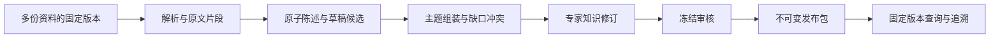

# UnifiedInfraOKB 运维知识管理

UnifiedInfraOKB 是 InfraUnifiedModel 中独立的运维知识管理后端模块。运维专家通过复用的 UnifiedInfraWeb 控制台，管理资料、多来源 AI 提取与知识组装、异常定义、告警映射、传播规则、审核和版本发布。

**当前仅建立目录骨架及需求交接文档。没有 go.mod、可执行程序、数据库迁移、运行配置、知识 API 或知识前端。** 目录存在不代表功能已经实现。

## 从哪里开始

1. 阅读 [模块协作约束](AGENTS.md)。
2. 阅读 [需求基线](docs/design/requirements.md)，理解已确认范围与 A01—A14 验收场景。
3. 阅读 [存储模型](docs/design/storage-model.md) 与 [工作流和页面](docs/design/workflows-and-ui.md)。
4. 查看 [接口边界](docs/design/api-boundaries.md)。
5. 使用 [开发接手入口](docs/development/README.md) 和 [工作包](docs/development/work-packages.md)分配任务；详细顺序见 [实施计划](docs/development/plans/2026-11-16-okb-implementation.md)。
6. 给另一个 AI 可直接复制 [接手提示词](docs/development/ai-handoff-prompt.md)，补上任务编号和实际 Git 基线。

## 已确认边界

- 同仓库独立后端，前端复用 UnifiedInfraWeb；优先 Go 技术生态。
- 独立 MySQL 知识数据库保存正文、来源、修订和流程记录；文件/私有对象存储保存原件和大对象。
- PostgreSQL、NebulaGraph、向量数据库和 OpenSPG/KAG 均不是本模块已确认的必装依赖。
- 当前独立建设知识管理，不关联实际拓扑，不使用或修改 TopologyDetails.vue，不调用 CMDB 或拓扑接口。
- 三类正式知识：异常类型、告警到多候选异常的映射、有条件的可能传播规则。
- 主题驱动组合多份资料，保留原文断言、出处、适用条件、冲突、缺口和专家判断。
- AI 输出是候选；专家通过网页处理，不需要编辑 YAML。发布包由系统导出并绑定固定修订和摘要。

## 知识流程

## 目录职责

| 路径 | 职责与当前状态 |
| --- | --- |
| cmd/server | 未来知识 HTTP API 入口；当前占位 |
| cmd/worker | 未来解析、提取及发布构建 worker 入口；当前占位 |
| api/v1 | 未来请求/响应契约与类型；当前占位 |
| internal/handler、service、repository、model | 未来传输、业务、持久化和领域代码；当前占位 |
| internal/document、extractor、storage、authorization、worker | 文档解析、模型适配、文件存储、授权和后台执行边界；当前占位 |
| migrations/mysql | 独立知识库迁移；当前没有 SQL |
| test/fixtures/synthetic、test/integration | 合成案例及未来集成验证；当前占位 |
| config | 未来无秘密的配置示例；当前占位 |
| docs/design | 需求、数据、流程和 API 设计 |
| docs/development | 实施顺序、工作包、任务和交付模板、接手说明 |

## 验证与运行

本轮仅能核对文档链接、目录、Git 改动和交接一致性。应用启动、go test、模型提取、MySQL 迁移及 Web 联调均尚不可执行或未经本轮验证；未来任务初始化后记录真实命令和输出。

资料原文、模型原始响应、真实案例、凭据和运行文件不进入 Git。原件与数据存放位置由部署配置指定。
